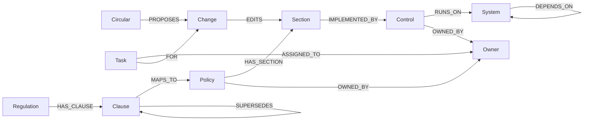

# RegulTrace

**Live demo: https://regultrace.vercel.app**

**Every new rule, traced to the people who must act.**

RegulTrace watches Indian regulators for new rules, checks each one against a company's own compliance documents, shows the blast radius as a graph, writes the exact policy edits, and puts a task in the inbox of every person who has to act. Built on FalkorDB for Graph Hacks: Context for AI Agents (WeMakeDevs × FalkorDB).

**Tracks:** Track 03, Company Brain (primary) · Track 01, Agents That Act on Connected Data

---

## 🔔 Inspiration: the rule was known, the person who had to act wasn't

In FY25 the Reserve Bank of India fined the companies it regulates **353 times, ₹54.78 crore in total**. The fines weren't for laws nobody had heard of. They were for KYC, cyber security and fraud reporting: rules that were known, where the link from the rule to the person who had to do something had broken.

264 of those 353 fines landed on co-operative banks, the institutions with the smallest compliance teams.

Here is how a regulatory change is still handled in most Indian fintechs, NBFCs and banks. A circular lands. The compliance lead reads it and opens an Excel "applicability matrix" that was last updated months ago. Then they email six departments: *"Does this affect you?"* And they wait. Two weeks later the matrix is stale again, because another circular has landed.

The volume is not slowing down:

- RBI regulates **9,291 NBFCs**, plus banks, co-operative banks and payment companies.
- On **28 November 2025** RBI folded **9,000+ circulars into about 240 Master Directions**. Every compliance map that pointed at an old circular number now points at superseded text.
- In January 2024 RBI told banks and larger NBFCs to use **technology tools for compliance monitoring** that "escalate non-compliance to the right stakeholder" (RBI/2023-24/117).
- The **DPDP Rules** were notified in November 2025. Most obligations apply from **13 May 2027**, with penalties of up to **₹250 crore**. Every company that handles Indian personal data is rewriting its policies right now.

Search tools and chatbots can find the documents that use the same words as a new rule. They can't tell you that the engineer who owns the deletion job has to change it, because that engineer's name never appears next to the word "erasure". That connection only exists in how the company is wired together, and that is a graph.

That's why I built RegulTrace.

## 🧭 What it does

RegulTrace sits inside the company. It already holds the company's compliance documents: every policy, its numbered sections, the processes that carry each section out, the systems those processes run on, and the person responsible for each one. All of it lives in one FalkorDB graph.

1. **It watches the regulator.** It reads RBI's live notification and press-release feeds every 30 minutes, and screens each publication: does this affect us? Treasury auctions and bank capital rules are set aside. You can also paste any regulation yourself.
2. **It finds what the rule touches.** FalkorDB retrieves the policy sections that match the regulation, then follows the graph to the processes, systems and people connected to them. That subgraph is the context the AI works from (GraphRAG).
3. **It shows the blast radius.** *"This touches 1 policy section, 2 processes, 2 systems and 3 people,"* drawn as a graph you can read top to bottom.
4. **It writes the change.** For each affected section it shows the current sentence, the replacement and the reason, like a redline.
5. **It tells each person what to do.** The policy owner gets "review and approve the new wording". Each process owner gets a concrete action. Everyone sees it in their own inbox, and can accept it, mark it done or ask a question.
6. **It shows its work.** Under every result, "How FalkorDB found this" shows the exact Cypher and how long it took.

A **Company graph** view shows every compliance document at once, with the responsible person on every box. Pick a regulation and everything it touches lights up.

## 🛠️ How I built it

**FalkorDB is the product, not a side database.** Every document, section, process, system, person, regulation, proposed change and inbox task is a node. The blast radius, the "who is responsible" lookup and every inbox are Cypher traversals. Without FalkorDB there is no answer to show.

**GraphRAG retrieval.** A FalkorDB full-text index on policy sections finds the sections that match the regulation's wording, ranked by how many of its terms they contain. The graph then expands to other sections that share a process with those matches, because if two sections are carried out by the same deletion job, a change to one puts the other at risk. Only that subgraph goes to the language model. For the sample DPDP amendment, it retrieves 4 of 24 sections in under a millisecond.

**Agent.** OpenAI GPT reads the regulation with the retrieved sections and returns structured JSON: the exact sentence that no longer complies, the replacement, the reason, and one action per affected process. The graph, not the model, decides who gets each task. The model can only cite section and process ids that came out of FalkorDB, and anything else is dropped. If there's no API key or the API fails, a rule-based analyser takes over, so the demo never dies.

**Live monitoring.** Python reads RBI's RSS feeds, stores each publication as a `Circular` node and de-duplicates by RBI's own id.

**Ask the docs, on the FalkorDB GraphRAG SDK.** The official GraphRAG SDK ingests PayNova's six policy documents into its own FalkorDB knowledge graph (`paynova_docs`), using a compliance ontology: Policy, Obligation, Process, Team, System, Regulator. Anyone can ask a plain-English question, such as "What is our deadline for erasure requests?", and the SDK answers from what it retrieves there, with the retrieved context shown. It runs on Gemini through a lightweight provider, and the deployment leaves out the SDK's optional local NER model, so it fits in a serverless function.

**Stack:** FalkorDB (Docker / Cloud) · FalkorDB GraphRAG SDK · Python · FastAPI · OpenAI GPT · Gemini · Cytoscape.js · Vercel.

## 🕸️ Graph data model



| Node | What it is | Example |
|---|---|---|
| `Policy` | A compliance document, with a version | Data Retention and Deletion Policy v3.1 |
| `Section` | A numbered section of a policy, full text indexed | §3 Erasure requests: "...within 45 days..." |
| `Control` | A process that carries a section out | Automated data-deletion job |
| `System` | Software the process runs on | User database, Data warehouse |
| `Owner` | The responsible person | Ravi, Data Engineering |
| `Circular` | A regulation from the live RBI feed or pasted in | DPDP (Amendment) Rules, 2026 |
| `Change` | A proposed redline: current, proposed, reason | 45 days → 30 days |
| `Task` | An action in someone's inbox, with a status | "Update the deletion job to finish within 30 days" |
| `Regulation`, `Clause` | Regulations the company already tracks; `SUPERSEDES` links amendments | DPDP erasure clause and its amendment |

## 🔎 The Cypher the product depends on

**GraphRAG retrieval:** full-text search per term, ranked by terms matched, then expand through shared processes.

```cypher
UNWIND $terms AS term
CALL db.idx.fulltext.queryNodes('Section', term) YIELD node
WITH node, count(DISTINCT term) AS matched
WHERE matched >= 2
WITH node, matched ORDER BY matched DESC LIMIT 4
OPTIONAL MATCH (node)-[:IMPLEMENTED_BY]->(:Control)<-[:IMPLEMENTED_BY]-(related:Section)
RETURN collect(DISTINCT node.id), collect(DISTINCT related.id)
```

**Blast radius:** from a regulation to the sections it changes, their processes, systems and people.

```cypher
MATCH change = (c:Circular {id: $id})-[:PROPOSES]->(:Change)-[:EDITS]->(s:Section)<-[:HAS_SECTION]-(p:Policy)
OPTIONAL MATCH run = (s)-[:IMPLEMENTED_BY]->(:Control)-[:RUNS_ON]->(:System)
OPTIONAL MATCH dep = (s)-[:IMPLEMENTED_BY]->(:Control)-[:RUNS_ON]->(:System)-[:DEPENDS_ON]->(:System)
OPTIONAL MATCH own = (s)-[:IMPLEMENTED_BY]->(:Control)-[:OWNED_BY]->(:Owner)
OPTIONAL MATCH approver = (p)-[:OWNED_BY]->(:Owner)
WITH collect(change) + collect(run) + collect(dep) + collect(own) + collect(approver) AS paths
UNWIND paths AS path
UNWIND relationships(path) AS r
RETURN DISTINCT startNode(r).id, type(r), endNode(r).id
```

**Who is responsible for every node in the company graph.**

```cypher
MATCH (n) WHERE n:Policy OR n:Section OR n:Control OR n:System OR n:Owner
OPTIONAL MATCH (n)-[:OWNED_BY]->(own:Owner)
OPTIONAL MATCH (doc:Policy)-[:HAS_SECTION]->(n)
OPTIONAL MATCH (doc)-[:OWNED_BY]->(approver:Owner)
OPTIONAL MATCH (ctl:Control)-[:RUNS_ON]->(n)
OPTIONAL MATCH (ctl)-[:OWNED_BY]->(operator:Owner)
RETURN n.id, labels(n)[0], coalesce(n.name, n.title), n.number, n.text, n.version, doc.name,
       collect(DISTINCT own.name) + collect(DISTINCT approver.name) + collect(DISTINCT operator.name)
```

**Amendments inherit what was already mapped**, however long the chain.

```cypher
MATCH chain = (c:Clause {id: $clause})-[:SUPERSEDES*0..]->(:Clause)-[:MAPS_TO]->(p:Policy)
OPTIONAL MATCH run = (p)-[:ENFORCED_BY]->(:Control)-[:RUNS_ON]->(:System)
OPTIONAL MATCH own = (p)-[:ENFORCED_BY*0..1]->()-[:OWNED_BY]->(:Owner)
WITH collect(chain) + collect(run) + collect(own) AS paths
UNWIND paths AS path
UNWIND relationships(path) AS r
RETURN DISTINCT startNode(r).id, type(r), endNode(r).id
```

All queries live in [`graph.py`](graph.py).

## 🚀 Run it locally

You need Docker, Python 3.12+ and [uv](https://docs.astral.sh/uv/).

```bash
docker run -d -p 6379:6379 -p 3000:3000 falkordb/falkordb:latest
uv sync
uv run python load_graph.py
uv run uvicorn server:app --port 8000
```

Open http://localhost:8000. The FalkorDB Browser is at http://localhost:3000 (graph `paynova`).

For GPT analysis, create a `.env` file with `OPENAI_API_KEY=...` (optional `OPENAI_MODEL`, default `gpt-5.5`). Without a key, RegulTrace uses its rule-based analyser.

For **Ask the docs**, add `GEMINI_API_KEY=...` to `.env` and build the GraphRAG SDK knowledge graph once:

```bash
uv run python ask_docs.py build
```

To check everything works before a demo:

```bash
uv run python demo_check.py
```

**Try it:** click **+ Paste a new regulation → Use a sample → Analyze impact**, then open Ravi's inbox, then the **Company graph** tab.

## 🧗 Challenges I ran into

1. **An amendment of an amendment found nothing.** My first query followed `SUPERSEDES` only one step back. The first amendment worked. A second amendment returned zero results, which would have broken live on stage. Making the traversal unbounded (`*0..`) fixed it, and the smoke test now checks a two-step chain.
2. **Full-text search ranked the wrong sections first.** One long OR query scored every "Scope" section above the section that actually mattered, because those sections mention "personal data". I moved the ranking into Cypher: search each term separately and rank sections by how many distinct terms they match. The erasure rule now retrieves Retention §3 first.
3. **Most real regulations don't matter to a fintech.** Today's RBI feed was forex dealing, capital adequacy and bond auctions. A keyword filter let a statistics bulletin through because it mentions "loans". GPT triage, with an explicit list of what never applies, fixed that.
4. **The rule-based fallback edited the wrong sentence.** "Processing stops within 7 days" got changed to 30 days because the sentence mentions erasure in passing. And in "acknowledged within 2 days and resolved within 30 days", it replaced the wrong deadline. Sentence-level matching and picking the deadline whose verb matches the regulation fixed both.
5. **Explaining compliance to normal humans.** My first UI showed "Clause, Control, System" panels side by side. The first person who tried it said they didn't understand anything. I rebuilt it as four plain steps: what changed, blast radius, what must change, who must act.

## 🏆 Accomplishments that I'm proud of

- **The graph does the work.** In the validated erasure scenario, keyword search finds 2 affected items; the graph finds 8, including the 3 people who have to act, none of whom appear next to the word "erasure".
- **Real GraphRAG.** FalkorDB's full-text index plus a graph hop picks the context. 4 of 24 sections, retrieved in under a millisecond.
- **Every answer shows its path and its query.** Nothing is a black box. The Cypher and its timing sit under every result.
- **Live, not mocked.** The regulation feed is RBI's real RSS feed, checked every 30 minutes.
- **The AI can't invent people.** Tasks are assigned by graph ownership, and the model can only reference ids FalkorDB returned.
- **It never dies on stage.** No key, no wifi to OpenAI, no problem: the rule-based analyser takes over.

## 📚 What I learned

**Technical:**
- Variable-length paths (`*0..`) are the difference between a demo and a product. A fixed depth looks right on test data and breaks on real chains.
- FalkorDB lets you call the full-text index procedure inside `UNWIND`, so ranking can happen in the database instead of in Python.
- `relationships()`, `startNode()` and `endNode()` turn a set of paths into a clean subgraph for drawing.
- FalkorDB doesn't support dynamic property keys (`n[$key]`); `SET n += $map` does the job.

**Non-technical:**
- Compliance teams don't need help *finding* a document. They need to know *who* has to act.
- Plain language beats completeness. Four clear steps win over six clever panels.

## 🔭 What's next for RegulTrace

**Immediate:** connect GPT triage to every new feed item, and add SEBI, IRDAI and MeitY feeds next to RBI.
**Short term:** import real policy documents (PDF, Confluence, Google Docs) into sections automatically; send tasks to Slack and email; when the policy owner approves, write the new section as a new version that `SUPERSEDES` the old one.
**Long term:** one isolated FalkorDB graph per company, deployed on FalkorDB Cloud, so every Indian fintech, NBFC and co-operative bank can see its blast radius the day a circular lands.

## 🤖 AI assistance (disclosure)

I used AI coding assistants during development, for research, scaffolding and writing code. I chose the problem and the product flow, made the design decisions, and tested every feature end to end. Inside the product, **OpenAI GPT** screens new regulations and drafts the policy redlines.

## 📄 Data

PayNova is a fictional company. Its policies, processes, systems and people are synthetic. Regulations come from RBI's public RSS feeds, or are pasted in by the user. No personal or private data is loaded into the graph.

## Built With

FalkorDB · Cypher · Python · FastAPI · OpenAI GPT · Cytoscape.js · Docker · RBI RSS feeds

## Sources

- [RBI list of registered NBFCs](https://website.rbi.org.in/documents/87730/39016390/ListofNBFCsandARCsregisteredwiththeRBI.pdf)
- [RBI penalties in FY25 (Business Standard)](https://www.business-standard.com/amp/finance/news/rbi-imposed-penalties-on-353-banks-other-regulated-entities-in-fy25-125060100307_1.html)
- [RBI consolidates 9,000+ circulars into Master Directions (Business Today)](https://www.businesstoday.in/amp/latest/economy/story/rbi-consolidates-9000-circulars-into-244-master-directions-for-enhanced-ease-of-doing-business-details-here-504215-2025-11-28)
- [RBI/2023-24/117 on compliance monitoring tools (ClearTax)](https://cleartax.in/s/internal-compliance-monitoring-rbi-circular-117)
- [DPDP Rules 2025 (PIB)](https://static.pib.gov.in/WriteReadData/specificdocs/documents/2025/nov/doc20251117695301.pdf)
